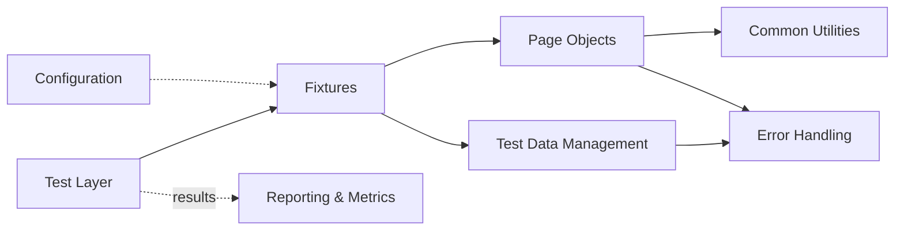

# SQAF — Software Quality Automation Framework

[](https://github.com/lisethportuguez/sqaf-playwright/actions/workflows/ci.yml)


A multi-layer functional test automation framework built with **Playwright** and **TypeScript**, designed to be maintainable, scalable and easy to integrate into QA processes.

SQAF is developed as the practical component of an undergraduate thesis (TFG) in Software Quality Management Engineering, and as a professional portfolio project.

> **Project status: Stage 2 — Page Objects and fixtures — in review (PR into `main`).** Stage 0 is closed and tagged `v0.1.0`; Stage 1 is closed, merged into `main` and tagged `v0.2.0`.
> Evidence: Stage 0 in [E0-baseline-runs.md](docs/validation/E0-baseline-runs.md), Stage 1 in [E1-configuration.md](docs/validation/E1-configuration.md), Stage 2 in [E2-page-objects-fixtures.md](docs/validation/E2-page-objects-fixtures.md).
> Stage 2 adds the Page Object layer (a small `BasePage`, three reusable components and eight pages), the fixtures layer (automatic ad blocking and one fixture per Page Object) and an `integration` project that verifies them. Test data management and the 15 SQAF functional scenarios are **not implemented yet**. See [Roadmap](#roadmap).

---

## Objectives

- Design a multi-layer architecture that separates tests, page objects, test data, utilities, error handling and reporting.
- Support **Page Object Model** and **Data-Driven Testing**.
- Provide centralized configuration, execution evidence and metrics.
- Integrate with **GitHub Actions** from the first stage.
- Evaluate the framework objectively against a baseline implementation.

## System Under Test

[Automation Exercise](https://automationexercise.com/) — a public e-commerce practice site with
[26 official test cases](https://automationexercise.com/test_cases) and a [public API](https://automationexercise.com/api_list).
SQAF targets 15 of those test cases (see [ADR-0002](docs/architecture/decisions/ADR-0002-sut-automation-exercise.md)).

## Architecture

Target architecture (see [architecture.md](docs/architecture/architecture.md)). Implemented so far: Configuration (Stage 1), Page Objects and Fixtures (Stage 2), and the infrastructure-failure parts of Error Handling and Reporting (Stage 1).



## Technology stack

| Tool | Version | Purpose |
|---|---|---|
| Node.js | 26 (`.nvmrc`) | Runtime |
| Playwright Test | 1.65.0 | Test runner and browser automation |
| TypeScript | 7.0.2 | Static typing (`strict`) — see [ADR-0004](docs/architecture/decisions/ADR-0004-typescript-7.md) |
| GitHub Actions | — | Continuous integration |

No additional runtime dependencies are used.

## Project structure

Current structure (Stage 2):

```
.
├── .github/workflows/ci.yml   # CI pipeline (path-filtered)
├── baseline/                  # Experimental baseline (no SQAF architecture, frozen)
│   └── baseline.spec.ts
├── config/                    # Configuration layer
│   ├── index.ts               # sqafConfig: single, validated, frozen entry point
│   ├── environments.ts        # Environment catalogue (production)
│   ├── environment.ts         # SQAF_ENV / SQAF_BASE_URL validation, optional .env
│   ├── timeouts.ts            # SQAF and baseline timeouts
│   ├── evidence.ts            # Trace / screenshot / video policy
│   ├── anti-bot.ts            # Observed Cloudflare challenge signatures
│   ├── locators.ts            # Locator policy (testIdAttribute: data-qa)
│   └── ad-blocking.ts         # Ad-blocking policy for the SUT
├── src/
│   ├── pages/                 # Page Objects: BasePage, 8 pages
│   │   └── components/        # Header, ProductCard, CartModal
│   ├── fixtures/              # Ad blocking + Page Object fixtures (single import: @sqaf/fixtures)
│   ├── errors/                # InfrastructureError, anti-bot guard, failure classification
│   ├── reporting/             # Failure classification reporter
│   └── utils/                 # Pure anti-bot challenge detector
├── tests/
│   ├── unit/                  # Framework unit tests (no browser, no SUT)
│   ├── integration/           # Page Object and fixture tests (Chromium)
│   └── e2e/                   # SQAF suites (from Stage 4)
├── docs/                      # Internal documentation (Spanish)
├── metrics/
│   ├── experiments/           # Experimental evidence (sanitized)
│   └── verification/          # Non-experimental verification runs (sanitized)
├── .env.example
├── LICENSE
├── playwright.config.ts
├── tsconfig.json
└── package.json
```

## Installation

Prerequisites: Node.js 26 and Git.

```bash
git clone <repository-url>
cd sqaf-playwright
npm ci
npx playwright install chromium
```

## Configuration

All settings come from the configuration layer (`config/index.ts`), are validated at startup and are immutable. See [ADR-0005](docs/architecture/decisions/ADR-0005-configuration-layer.md).

| Variable | Values | Default |
|---|---|---|
| `SQAF_ENV` | `production` | `production` |
| `SQAF_BASE_URL` | An `http(s)` origin, without path, query or credentials | The environment's URL |

- A local `.env` file is optional (copy `.env.example`). It is loaded with Node's native `process.loadEnvFile()` and never overrides variables already set in the shell or in CI.
- Invalid values stop the run before any test executes, with a `ConfigurationError` that names the variable and the allowed values.
- **The experimental baseline ignores both variables**: it always runs against `https://automationexercise.com` with its frozen Stage 0 conditions (Chromium, 1 worker, 0 retries, 30 s test / 5 s expect timeouts, no trace, screenshots or video). A contract test enforces this.

## Writing a SQAF test

SQAF suites import `test` and `expect` from the fixtures layer only, and receive Page Objects as fixtures:

```ts
import { expect, test } from '@sqaf/fixtures';

test('search products', async ({ homePage, productsPage }) => {
  await homePage.open();
  await homePage.header.goToProducts();
  await productsPage.waitUntilReady();

  await productsPage.search('Jeans');

  await expect(productsPage.searchedProductsHeading).toBeVisible();
});
```

- Every test gets a fresh browser context with the ad-blocking policy applied automatically.
- `open()` and `waitUntilReady()` wait for the `load` event, fail with an `InfrastructureError` if the SUT answers with its anti-bot challenge, and then check the page's own readiness marker.
- Page Objects expose locators and business actions; assertions stay in the tests. See [ADR-0007](docs/architecture/decisions/ADR-0007-page-objects-fixtures.md).

## Execution commands

| Command | Description |
|---|---|
| `npm run typecheck` | TypeScript type checking (`tsc --noEmit`) |
| `npm run test:unit` | Runs the framework unit tests (no browser, no SUT) |
| `npm run test:baseline` | Runs the 5 baseline scenarios on Chromium |
| `npm run test:integration` | Runs the Page Object and fixture integration tests on Chromium |
| `npm test` | Runs all Playwright projects (currently the unit tests, the baseline and the integration tests) |
| `npm run report` | Opens the last HTML report |

## Reporting

Playwright's HTML report is generated in `playwright-report/` (not versioned). In CI it is uploaded as a workflow artifact.

Every failed attempt is also classified by an observer reporter (`infrastructure/anti-bot-challenge` or `unclassified`) and written to the console, to `reports/failure-classification.json` and, in CI, to the job summary. The classification never changes test statuses, retries or the exit code. See [ADR-0006](docs/architecture/decisions/ADR-0006-infrastructure-failure-classification.md).

Multi-format reporting and a custom metrics reporter are planned for Stage 6.

## CI/CD

The [CI workflow](.github/workflows/ci.yml) runs on push to `main`, on pull requests and on manual dispatch:

`checkout → setup Node (.nvmrc) → npm ci → typecheck → unit tests → install Chromium → baseline (1 worker) → upload HTML report (+ failure evidence on failure) → integration tests → upload integration report (+ integration failure evidence on failure)`

The integration tests run after the baseline and its evidence upload, so they never affect the baseline run. They have their own output folders and artifacts.

Changes that touch **only** documentation (`docs/**` or Markdown files) do not trigger the workflow, so the external SUT is not hit without need. Code, configuration, tests, workflows and dependency manifests always trigger it. A manual run (`workflow_dispatch`) is never filtered and always runs the full pipeline, baseline included. See [ADR-0003](docs/architecture/decisions/ADR-0003-ci-github-actions.md).

## Metrics

Metric definitions and the experimental comparison (baseline vs. SQAF) are planned for Stages 6–7. Stage 0 run records: [E0-baseline-runs.md](docs/validation/E0-baseline-runs.md). Raw (sanitized) evidence of the six local Stage 0 baseline executions, including the failed ones: [metrics/experiments/E0-baseline](metrics/experiments/E0-baseline/). Non-experimental verification runs (for example, the Stage 1 and Stage 2 checks that the baseline still passes under its frozen conditions) are kept separately in [metrics/verification](metrics/verification/) and are not part of the experimental dataset.

## Roadmap

Status legend: **Planned** (designed only) · **Implemented** (code exists and typechecks) · **Validated** (verified by a real execution with recorded evidence).

| Stage | Capability | Status |
|---|---|---|
| 0 | Git repository, `.gitignore`, `.gitattributes` | Validated |
| 0 | TypeScript 7 strict configuration (`npm run typecheck`) | Validated |
| 0 | Experimental baseline — 5 scenarios (TC1, TC3, TC8, TC9, TC12) | Validated (local, 3 runs) |
| 0 | Ad-blocking policy for the SUT | Validated (local) |
| 0 | GitHub Actions CI workflow | Validated (run [43689246937](https://github.com/lisethportuguez/sqaf-playwright/actions/runs/43689246937)) |
| 1 | Configuration layer (environments, variables, timeouts, evidence policy, frozen baseline) | Validated (CI run [43693825486](https://github.com/lisethportuguez/sqaf-playwright/actions/runs/43693825486)) |
| 1 | Anti-bot challenge detection and infrastructure failure classification | Validated by unit tests in CI run [43693825486](https://github.com/lisethportuguez/sqaf-playwright/actions/runs/43693825486), using the signatures and messages observed in CI; not yet exercised against a live challenge |
| 1 | CI unit-test step and path filters | Validated (CI run [43693825486](https://github.com/lisethportuguez/sqaf-playwright/actions/runs/43693825486); path filters checked with real events) |
| 1 | CI failure-evidence artifact | Implemented (not yet exercised: no CI failure since Stage 1) |
| 2 | Page Object layer (`BasePage`, Header, ProductCard, CartModal, 8 pages) | Validated locally (integration tests); CI: see [E2-page-objects-fixtures.md](docs/validation/E2-page-objects-fixtures.md) |
| 2 | Fixtures layer (automatic ad blocking, one fixture per Page Object, `@sqaf/fixtures`) | Validated locally (integration tests); CI: see [E2-page-objects-fixtures.md](docs/validation/E2-page-objects-fixtures.md) |
| 2 | Anti-bot guard wired into page navigation | Validated with a simulated challenge (offline); not yet exercised against a live challenge |
| 2 | Layer dependency rule check | Validated (unit test with controlled mutations) |
| 2 | CI integration step with separate artifacts | Implemented; CI: see [E2-page-objects-fixtures.md](docs/validation/E2-page-objects-fixtures.md) |
| 3 | Test Data Management (JSON, typed data, API user provisioning) | Planned |
| 4 | Test layer — 15 functional scenarios, tags, traceability | Planned |
| 5 | Common utilities and error handling | Planned |
| 6 | Reporting and metrics (HTML, JSON, JUnit, MetricsReporter) | Planned |
| 7 | Experimental validation and results | Planned |

## Limitations

- The SUT is a public third-party website: availability and content are outside the project's control.
- Advertising hosts are blocked during test execution, so tests do not reproduce the exact ad-supported user experience.
- Only Chromium is used so far; Firefox and WebKit projects are defined but have no tests until Stage 4.
- Stage 2 creates no accounts: the account confirmation pages, logout and account deletion are implemented but not yet exercised against the SUT (Stages 3–4).
- The SUT is served through Cloudflare and may answer CI runners with an anti-bot challenge page. Such failures are detected and classified as infrastructure failures, but they still fail the run: SQAF does not try to bypass the challenge.

## Documentation

- [Architecture](docs/architecture/architecture.md)
- [Architecture Decision Records](docs/architecture/decisions/)
- [Stage 0 validation records](docs/validation/E0-baseline-runs.md)
- [Stage 1 validation records](docs/validation/E1-configuration.md)
- [Stage 2 validation records](docs/validation/E2-page-objects-fixtures.md)
- [Stage 0 baseline evidence](metrics/experiments/E0-baseline/)

## Versioning

Repository milestones are marked with Git tags (`v0.1.0` Stage 0, `v0.2.0` Stage 1). The `version` field in `package.json` is intentionally left at `0.1.0`: the package is private and never published, and changing the field would also rewrite `package-lock.json`, which is kept unchanged across stages. Tags, not `package.json`, identify each stage.

## License

Released under the [MIT License](LICENSE). © 2026 Liseth Portuguez.
