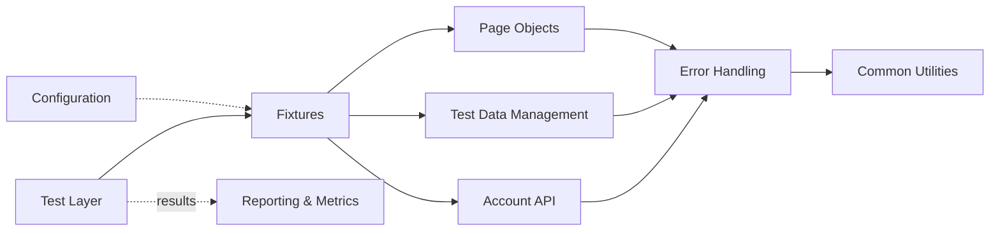

# SQAF — Software Quality Automation Framework

[](https://github.com/lisethportuguez/sqaf-playwright/actions/workflows/ci.yml)


A multi-layer functional test automation framework built with **Playwright** and **TypeScript**, designed to be maintainable, scalable and easy to integrate into QA processes.

SQAF is developed as the practical component of an undergraduate thesis (TFG) in Software Quality Management Engineering, and as a professional portfolio project.

> **Project status: Stages 0 to 5 are closed, merged into `main` and tagged `v0.1.0` to `v0.5.0`** (Stages 3 and 5 were delivered together as cycle 1 in PR [#6](https://github.com/lisethportuguez/sqaf-playwright/pull/6); Stage 4 in PR [#8](https://github.com/lisethportuguez/sqaf-playwright/pull/8)). **Stage 6, Allure Report integration, is closed:** PR [#10](https://github.com/lisethportuguez/sqaf-playwright/pull/10) merged into `main` (`72ea7f4`) and validated by the `main` CI run [44215539394](https://github.com/lisethportuguez/sqaf-playwright/actions/runs/44215539394) (attempt 2; attempt 1 was blocked by Cloudflare's anti-bot challenge on the baseline), which published the first Allure history entry. Not tagged. The MetricsReporter of Stage 6 is still planned.
> Evidence: Stage 0 in [E0-baseline-runs.md](docs/validation/E0-baseline-runs.md), Stage 1 in [E1-configuration.md](docs/validation/E1-configuration.md), Stage 2 in [E2-page-objects-fixtures.md](docs/validation/E2-page-objects-fixtures.md), Stage 5 in [E5-utilities-error-handling.md](docs/validation/E5-utilities-error-handling.md), Stage 3 in [E3-test-data-management.md](docs/validation/E3-test-data-management.md), Stage 4 in [E4-functional-scenarios.md](docs/validation/E4-functional-scenarios.md), Stage 6 (Allure Report) in [E6-allure-report.md](docs/validation/E6-allure-report.md).
> Cycle 1 adds the error hierarchy and the full failure taxonomy, common utilities, JSON datasets with typed providers and runtime validation, data factories, data-driven tests and API account provisioning with verified cleanup. The 15 SQAF functional scenarios are implemented (Stage 4); they are not run in CI yet. See [Roadmap](#roadmap).

---

## Objectives

- Design a multi-layer architecture that separates tests, page objects, test data, utilities, error handling and reporting.
- Support **Page Object Model** and **Data-Driven Testing**.
- Provide centralized configuration, execution evidence and metrics.
- Integrate with **GitHub Actions** from the first stage.
- Evaluate the framework objectively against a baseline implementation.

## System Under Test

[Automation Exercise](https://automationexercise.com/) — a public e-commerce practice site with
[26 official test cases](https://automationexercise.com/test_cases) and a [public API](https://automationexercise.com/api_list).
SQAF targets 15 of those test cases (see [ADR-0002](docs/architecture/decisions/ADR-0002-sut-automation-exercise.md)).

## Architecture

Target architecture (see [architecture.md](docs/architecture/architecture.md)). Implemented so far: Configuration (Stage 1), Page Objects and Fixtures (Stage 2), Test Data Management and the Account API (Stage 3), Common Utilities and Error Handling (Stage 5), and the failure-classification part of Reporting (Stages 1 and 5).



The thesis methodology describes a flat reference tree (`tests/authentication`, `tests/products`, `tests/checkout`, `pages/`, `data/`, `fixtures/`, `utils/`, `config/`, `reports/`, `test-results/`). The repository implements the same responsibilities as layers under `src/` plus `test-data/`; the correspondence table is in [architecture.md §7](docs/architecture/architecture.md#7-correspondencia-con-la-estructura-metodológica-del-tfg).

## Technology stack

| Tool | Version | Purpose |
|---|---|---|
| Node.js | 26 (`.nvmrc`) | Runtime |
| Playwright Test | 1.65.0 | Test runner and browser automation |
| TypeScript | 7.0.2 | Static typing (`strict`) — see [ADR-0004](docs/architecture/decisions/ADR-0004-typescript-7.md) |
| GitHub Actions | — | Continuous integration |

No additional runtime dependencies are used.

## Project structure

Current structure (Stages 0–3 and 5):

```
.
├── .github/workflows/ci.yml   # CI pipeline (path-filtered)
├── baseline/                  # Experimental baseline (no SQAF architecture, frozen)
│   └── baseline.spec.ts
├── config/                    # Configuration layer
│   ├── index.ts               # sqafConfig: single, validated, frozen entry point
│   ├── environments.ts        # Environment catalogue (production)
│   ├── environment.ts         # SQAF_ENV / SQAF_BASE_URL validation, optional .env
│   ├── timeouts.ts            # SQAF, baseline and API timeouts
│   ├── test-data.ts           # Location of the JSON datasets
│   ├── evidence.ts            # Trace / screenshot / video policy
│   ├── anti-bot.ts            # Observed Cloudflare challenge signatures
│   ├── locators.ts            # Locator policy (testIdAttribute: data-qa)
│   └── ad-blocking.ts         # Ad-blocking policy for the SUT
├── src/
│   ├── pages/                 # Page Objects: BasePage, 8 pages
│   │   └── components/        # Header, ProductCard, CartModal
│   ├── fixtures/              # Ad blocking, Page Object, data and account fixtures (single import: @sqaf/fixtures)
│   ├── data/                  # Test Data Management: types, validation, datasets, providers, factories
│   ├── api/                   # Account API client (create / find / delete)
│   ├── errors/                # SqafError hierarchy, anti-bot guard, failure taxonomy
│   ├── reporting/             # Failure classification, safe run summary and sanitized Allure reporters
│   └── utils/                 # Pure helpers: text, price, unique ids, durations, guards, anti-bot detector
├── test-data/                 # Static JSON datasets
│   ├── users/                 # Account profiles, invalid credentials
│   ├── products/              # Catalog subset, search terms
│   └── checkout/              # Test payment cards
├── tests/
│   ├── unit/                  # Framework unit tests (no browser, no SUT)
│   ├── integration/           # Page Object, fixture, data-driven and account tests (Chromium)
│   └── e2e/                   # SQAF functional scenarios (Stage 4): authentication/, products/, checkout/
├── docs/                      # Internal documentation (Spanish)
├── metrics/
│   ├── experiments/           # Experimental evidence (sanitized)
│   └── verification/          # Non-experimental verification runs (sanitized)
├── .env.example
├── LICENSE
├── playwright.config.ts
├── tsconfig.json
└── package.json
```

## Installation

Prerequisites: Node.js 26 and Git.

```bash
git clone <repository-url>
cd sqaf-playwright
npm ci
npx playwright install chromium
```

## Configuration

All settings come from the configuration layer (`config/index.ts`), are validated at startup and are immutable. See [ADR-0005](docs/architecture/decisions/ADR-0005-configuration-layer.md).

| Variable | Values | Default |
|---|---|---|
| `SQAF_ENV` | `production` | `production` |
| `SQAF_BASE_URL` | An `http(s)` origin, without path, query or credentials | The environment's URL |

- A local `.env` file is optional (copy `.env.example`). It is loaded with Node's native `process.loadEnvFile()` and never overrides variables already set in the shell or in CI.
- Invalid values stop the run before any test executes, with a `ConfigurationError` that names the variable and the allowed values.
- **The experimental baseline ignores both variables**: it always runs against `https://automationexercise.com` with its frozen Stage 0 conditions (Chromium, 1 worker, 0 retries, 30 s test / 5 s expect timeouts, no trace, screenshots or video). A contract test enforces this.

## Writing a SQAF test

SQAF suites import `test` and `expect` from the fixtures layer only, and receive Page Objects as fixtures:

```ts
import { expect, test } from '@sqaf/fixtures';

test('search products', async ({ homePage, productsPage }) => {
  await homePage.open();
  await homePage.header.goToProducts();
  await productsPage.waitUntilReady();

  await productsPage.search('Jeans');

  await expect(productsPage.searchedProductsHeading).toBeVisible();
});
```

- Every test gets a fresh browser context with the ad-blocking policy applied automatically.
- `open()` and `waitUntilReady()` wait for the `load` event, fail with an `InfrastructureError` if the SUT answers with its anti-bot challenge, and then check the page's own readiness marker.
- Page Objects expose locators and business actions; assertions stay in the tests. See [ADR-0007](docs/architecture/decisions/ADR-0007-page-objects-fixtures.md).

### Test data and data-driven tests

Static data lives in JSON files under `test-data/`, is validated at load time (any structural problem raises a `DataValidationError` that lists every issue) and reaches the suites through `@sqaf/fixtures`. A data-driven test is a plain loop: Playwright generates one test per dataset case.

```ts
import { caseTitle, expect, test, testData } from '@sqaf/fixtures';

for (const credentials of testData.invalidCredentials.all()) {
  test(caseTitle('rejects an invalid login', credentials), async ({ signupLoginPage }) => {
    await signupLoginPage.open();
    await signupLoginPage.login(credentials);
    await expect(signupLoginPage.loginError).toHaveText(credentials.expectedError);
  });
}
```

Users come from fixtures:

| Fixture | Provides | Cleanup |
|---|---|---|
| `newUserData` | A unique, validated user that does **not** exist yet (for UI registration) | Deletes the account through the API in case the test registered it |
| `testUser` | A unique user **created through the API** before the test | Deletes it through the API and verifies that it no longer exists |
| `accountApi` | The account API client | — |
| `userProfile` (option) | Profile used by both user fixtures: `test.use({ userProfile: 'united-states-minimal' })` | — |

E-mails are always synthetic (`sqaf.<id>@example.com`); passwords are random and never logged. See [ADR-0009](docs/architecture/decisions/ADR-0009-test-data-management.md).

A spec file that uses `testUser`, `newUserData` or `accountApi` must declare the credential-safe evidence policy at its top level; otherwise those fixtures fail before creating any account:

```ts
import { CREDENTIAL_SAFE_EVIDENCE, test } from '@sqaf/fixtures';

test.use(CREDENTIAL_SAFE_EVIDENCE); // no trace, no video, screenshot on failure
```

Playwright traces store form bodies and typed values, so these tests run without them. Page Objects type passwords with `fillSecret` (the value never appears in a step title), and after each test the fixtures empty password inputs and redact passwords from the test errors. Every other test keeps the general evidence policy.

## Execution commands

| Command | Description |
|---|---|
| `npm run typecheck` | TypeScript type checking (`tsc --noEmit`) |
| `npm run test:unit` | Runs the framework unit tests (no browser, no SUT) |
| `npm run test:baseline` | Runs the 5 baseline scenarios on Chromium |
| `npm run test:integration` | Runs the integration tests on Chromium (Page Objects, fixtures, data-driven tests and account provisioning; 2 tests create and delete one account each) |
| `npm run test:e2e` | Runs the SQAF functional scenarios (`tests/e2e`) on Chromium. Scenarios tagged `@account` create one synthetic account each and delete it; filter with `--grep @smoke` or `--grep-invert @account` |
| `npm test` | Runs all Playwright projects (currently the unit tests, the baseline and the integration tests) |
| `npm run report` | Opens the last HTML report |
| `npm run test:allure` | Integration and functional scenarios in one run, with the failure classification, the safe summary and the sanitized Allure report (`allure-report/`): one report and one history entry |
| `npm run test:e2e:allure` | Same as `test:e2e`, plus the classification, the safe summary and the Allure report (combined with the last prepared integration results; appends one history entry) |
| `npm run test:integration:allure` | Same as `test:integration`, plus the sanitized Allure report (no history entry: integration only) |
| `npm run report:allure` | Serves the Allure report on `127.0.0.1` only (or open `allure-report/awesome/index.html` directly) |

## Reporting

Playwright's HTML report is generated in `playwright-report/` (not versioned) for local runs. **CI publishes no HTML report.** The baseline HTML report is generated but never published, because it records typed values such as the baseline's test password ([INC-2026-11-16](docs/security/INC-2026-11-16-baseline-report-credentials.md)); the baseline publishes its failure classification JSON instead. The integration and functional-scenario steps generate no HTML report at all, because it would show the synthetic test-account e-mails (Playwright writes typed values in `Fill` step titles); they publish a safe summary instead (Stage 4, E4.5).

Every failed attempt is also classified by an observer reporter and written to the console, to `reports/failure-classification.json` and, in CI, to the job summary. The error excerpt stored in that JSON is redacted (typed values and secret-looking pairs). Since Stage 5 the taxonomy is:

| Classification | Meaning |
|---|---|
| `infrastructure/anti-bot-challenge` | The SUT answered with its Cloudflare challenge page |
| `infrastructure/network` | Network or DNS failure (`net::ERR_*`, `ECONNREFUSED`, `getaddrinfo ...`) |
| `infrastructure/sut-unavailable` | The page the attempt ended on was served with HTTP 5xx (structured evidence recorded by the fixtures), or a 5xx error page/answer of the SUT |
| `test-data/invalid` | A dataset or factory result failed its validation (`DataValidationError`) |
| `api/request-failed` | The SUT API answered unexpectedly (`ApiError`) |
| `automation/locator-timeout` | A Playwright action timed out waiting for a locator |
| `assertion/mismatch` | A failed `expect(...)` assertion |
| `unclassified` | Anything else |

The classification never changes test statuses, retries or the exit code. See [ADR-0006](docs/architecture/decisions/ADR-0006-infrastructure-failure-classification.md) and [ADR-0008](docs/architecture/decisions/ADR-0008-error-handling-utilities.md).

### Allure Report (Stage 6)

`npm run test:allure` (or `test:e2e:allure` / `test:integration:allure`) also builds an [Allure 3](https://allurereport.org/) report: results grouped by suite, module (Authentication, Products, Checkout) and scenario, with each scenario's steps and durations, SQAF failure categories, allowed screenshots and a history of trends between runs (`allure-history/`). Allure is a view, not an official record: the classification JSON and the safe summary stay the reference, and Allure only reads the classification.

The report is built fail-closed ([ADR-0011](docs/architecture/decisions/ADR-0011-allure-report.md)):

- allure-playwright runs with `detail: false` (no `Fill "<value>"` action steps).
- A SQAF preparation step sanitizes every text (e-mails, passwords, card numbers, account data ids, typed values, local paths, machine name) and drops all attachments except failure screenshots of the suites that use no accounts.
- A scanner decodes the base64 data of the single-file report and checks the prepared results, the report and the history. Any finding deletes the report and restores the previous history.

Raw results (`allure-results/`) never leave the machine or the runner and are never used to build the report. Allure is not a configured reporter, so the baseline and the other runs are unchanged. Only failure screenshots of the suites that use no accounts appear (the same suites whose failure evidence CI publishes); screenshots are images and cannot be scanned, so that allowlist is their only protection. History: one entry per complete run (an integration-only run does not append one).

**In CI** (Stage 6, Phase 3), the integration and functional-scenario steps add the same reporter. CI publishes **only** the scanned single-file report as the `allure-report-<run>-<attempt>` artifact (14 days); the raw and prepared results are never published. The history is downloaded read-only from the latest push run on `main` and is published (`allure-history-<run>-<attempt>`, 90 days) only by push runs on `main`; pull requests read it but never write it. If the pipeline finds sensitive data, nothing is published and the run fails in "Check Allure pipeline". The workflow needs `actions: read` (to read earlier artifacts) besides `contents: read`; GitHub Pages is not used. How to run and read the reports: [user guide](docs/user-guide.md).

A custom metrics reporter is planned for Stage 6.

## CI/CD

The [CI workflow](.github/workflows/ci.yml) runs on push to `main`, on pull requests and on manual dispatch:

`checkout → setup Node (.nvmrc) → npm ci → typecheck → unit tests → install Chromium → baseline (1 worker) → upload baseline classification JSON (+ failure classification as failure evidence, on failure; no raw test outputs) → integration tests → upload integration safe summary (+ failure evidence of the integration suites without accounts, on failure) → functional scenarios → upload e2e safe summary (+ product-suite failure evidence on failure)`

The integration tests run after the baseline and its evidence upload, so they never affect the baseline run. They have their own output folders and artifacts. Since the Stage 4 security closure (implemented locally, not yet run on GitHub Actions), the integration step no longer publishes its HTML report: it publishes the same safe summary as the functional scenarios and, on failure, only the evidence of the suites that use no test accounts, e-mails, passwords or card data. Nothing CI publishes contains an e-mail, an account data id, a password or a card number, and error messages in the job log show e-mails only as `[e-mail redacted]`. When the unit tests or the baseline fail, CI publishes only the redacted failure classification, never raw test outputs. Runtime tests check this against a fake SUT and synthetic failing samples.

**Functional scenarios (Stage 4, E4.5 — implemented locally, not yet run on GitHub Actions):** after the integration tests, `npm run test:e2e` (Chromium, 1 worker, the CI retries of `playwright.config.ts`) runs only the `@smoke` scenarios on pull requests (9 tests, 2 test accounts) and the full suite on pushes to `main` and manual runs (18 tests, 8 test accounts). For safety, this step generates **no HTML report and no raw JSON** (they would hold the synthetic test-account e-mails). It publishes only a safe summary (`reports/run-summary.json` and a job-summary table: outcome, attempts, duration and failure classification per test, flaky tests included). On failure, it publishes the evidence of the product suites only, never that of the authentication and checkout suites. A running workflow run is never cancelled (on pull requests or on `main`): a newer push waits for it, so every test account reaches its cleanup.

Changes that touch **only** documentation (`docs/**` or Markdown files) do not trigger the workflow, so the external SUT is not hit without need. Code, configuration, tests, workflows and dependency manifests always trigger it. A manual run (`workflow_dispatch`) is never filtered and always runs the full pipeline, baseline included. See [ADR-0003](docs/architecture/decisions/ADR-0003-ci-github-actions.md).

## Metrics

Metric definitions and the experimental comparison (baseline vs. SQAF) are planned for Stages 6–7. Stage 0 run records: [E0-baseline-runs.md](docs/validation/E0-baseline-runs.md). Raw (sanitized) evidence of the six local Stage 0 baseline executions, including the failed ones: [metrics/experiments/E0-baseline](metrics/experiments/E0-baseline/). Stage 4 local measurement of the 15 SQAF scenarios (3 runs, per-test results and durations, failure classification, account cleanup, artifact scan, maintainability metrics and a descriptive comparison with E0): [metrics/experiments/E4-sqaf](metrics/experiments/E4-sqaf/) (extracted values only; the raw reports are not versioned because they contain the synthetic test-account e-mails). Non-experimental verification runs (for example, the Stage 1 and Stage 2 checks that the baseline still passes under its frozen conditions) are kept separately in [metrics/verification](metrics/verification/) and are not part of the experimental dataset.

## Roadmap

Status legend: **Planned** (designed only) · **Implemented** (code exists and typechecks) · **Validated** (verified by a real execution with recorded evidence).

| Stage | Capability | Status |
|---|---|---|
| 0 | Git repository, `.gitignore`, `.gitattributes` | Validated |
| 0 | TypeScript 7 strict configuration (`npm run typecheck`) | Validated |
| 0 | Experimental baseline — 5 scenarios (TC1, TC3, TC8, TC9, TC12) | Validated (local, 3 runs) |
| 0 | Ad-blocking policy for the SUT | Validated (local) |
| 0 | GitHub Actions CI workflow | Validated (run [43689246937](https://github.com/lisethportuguez/sqaf-playwright/actions/runs/43689246937)) |
| 1 | Configuration layer (environments, variables, timeouts, evidence policy, frozen baseline) | Validated (CI run [43693825486](https://github.com/lisethportuguez/sqaf-playwright/actions/runs/43693825486)) |
| 1 | Anti-bot challenge detection and infrastructure failure classification | Validated by unit tests in CI run [43693825486](https://github.com/lisethportuguez/sqaf-playwright/actions/runs/43693825486), using the signatures and messages observed in CI; not yet exercised against a live challenge |
| 1 | CI unit-test step and path filters | Validated (CI run [43693825486](https://github.com/lisethportuguez/sqaf-playwright/actions/runs/43693825486); path filters checked with real events) |
| 1 | CI failure-evidence artifact | Implemented (not yet exercised: no CI failure since Stage 1) |
| 2 | Page Object layer (`BasePage`, Header, ProductCard, CartModal, 8 pages) | Validated (local and CI run [43755588344](https://github.com/lisethportuguez/sqaf-playwright/actions/runs/43755588344), integration tests) |
| 2 | Fixtures layer (automatic ad blocking, one fixture per Page Object, `@sqaf/fixtures`) | Validated (local and CI run [43755588344](https://github.com/lisethportuguez/sqaf-playwright/actions/runs/43755588344), integration tests) |
| 2 | Anti-bot guard wired into page navigation | Validated with a simulated challenge (offline); not yet exercised against a live challenge |
| 2 | Layer dependency rule check | Validated (unit test with controlled mutations) |
| 2 | CI integration step with separate artifacts | Validated (CI run [43755588344](https://github.com/lisethportuguez/sqaf-playwright/actions/runs/43755588344)); integration failure-evidence artifact not yet exercised |
| 3 | Test Data Management: JSON datasets, runtime validation, typed providers, factories | Validated (local and CI runs [43800662549](https://github.com/lisethportuguez/sqaf-playwright/actions/runs/43800662549) and [43802704575](https://github.com/lisethportuguez/sqaf-playwright/actions/runs/43802704575)) |
| 3 | Data-driven tests (invalid credentials, product search, user profiles) | Validated (5 SUT cases + offline cases, local and CI) |
| 3 | Account API client and `newUserData` / `testUser` fixtures with verified cleanup | Validated (2 SUT tests per run, cleanup verified through the API, local and CI) |
| 3 | Credential-safe evidence policy (no trace or video for tests that handle passwords) | Validated (runtime contract with a fake SUT, local and CI) |
| 4 | Test layer — 15 functional scenarios, tags, traceability | Validated (local and CI): 15 scenarios, 18 tests on Chromium; integrated in CI (E4.5: `@smoke` on pull requests, full suite on `main`) and merged in PR [#8](https://github.com/lisethportuguez/sqaf-playwright/pull/8) (`main` CI run [43983759599](https://github.com/lisethportuguez/sqaf-playwright/actions/runs/43983759599): e2e 18/18); E4.4 local measurement: 3 runs, 50/54 passed, 0 functional failures, 4 SUT HTTP 503 failures, 24 accounts all deleted and verified; traceability contract in place ([summary](metrics/experiments/E4-sqaf/summary.json), [record](docs/validation/E4-functional-scenarios.md)) |
| 5 | Error hierarchy (`SqafError`, `DataValidationError`, `ApiError`) and full failure taxonomy | Validated (local and CI); real failures observed: a local DNS failure and an HTTP 503 of the SUT in CI, now classified from structured HTTP evidence |
| 5 | Common utilities (price, unique ids/e-mails, text, durations, guards, secret redaction) | Validated (unit tests, local and CI) |
| 6 | Reporting and metrics: sanitized Allure report with history | Validated (local and CI, [ADR-0011](docs/architecture/decisions/ADR-0011-allure-report.md), [record](docs/validation/E6-allure-report.md)); `main` CI run [44215539394](https://github.com/lisethportuguez/sqaf-playwright/actions/runs/44215539394): unit 394, baseline 5, integration 40, e2e 18, 58/58 Allure results, report and first history entry published and scanned clean (trends start with one point) |
| 6 | Reporting and metrics: MetricsReporter and remaining formats | Planned |
| 7 | Experimental validation and results | Planned |

## Limitations

- The SUT is a public third-party website: availability and content are outside the project's control.
- Advertising hosts are blocked during test execution, so tests do not reproduce the exact ad-supported user experience.
- Only Chromium is used; the Firefox and WebKit projects are defined but out of the current scope.
- The functional scenarios are not run in CI yet: the CI step (`@smoke` on pull requests, the full suite on `main`) is implemented locally but has not run on GitHub Actions. Since Stage 3, two integration tests create one synthetic account each through the API and delete it in the same run.
- The baseline HTML report is not published in CI, so a baseline failure in CI is diagnosed from the console log, the job summary and the classification JSON; detailed diagnosis means reproducing it locally. If the baseline's `fill(password)` failed after locating its field, Playwright would print the typed value in the CI console log (see [INC-2026-11-16](docs/security/INC-2026-11-16-baseline-report-credentials.md)).
- Error messages, logs and published summaries replace every e-mail address with `[e-mail redacted]`, without the account data id (Stage 4 final security closure), so a failed account test can only be traced to its account locally (the data id is in the `sqaf-account-cleanup` attachment and the `sqaf-test-data` annotation, which CI never publishes). Since Playwright's HTML report is not published in CI, integration and account-scenario failures are diagnosed from the console log, the safe summary, the job summary and the sanitized Allure report, or by reproducing them locally.
- The Allure report shows failure screenshots only for the suites without accounts; the scanner cannot read images, so the suite allowlist is their only protection ([ADR-0011](docs/architecture/decisions/ADR-0011-allure-report.md)). Updating Allure requires reviewing the pinned static-resource hashes of the scanner (the scan fails until then).
- Tests that handle account credentials run without trace or video (screenshots are kept on failure), so their failures are harder to diagnose than those of other tests. Suites must not assert on a password value: the failed step message would end up in the HTML report.
- The SUT is served through Cloudflare and may answer CI runners with an anti-bot challenge page. Such failures are detected and classified as infrastructure failures, but they still fail the run: SQAF does not try to bypass the challenge.

## Documentation

- [Architecture](docs/architecture/architecture.md)
- [Architecture Decision Records](docs/architecture/decisions/)
- [Stage 0 validation records](docs/validation/E0-baseline-runs.md)
- [Stage 1 validation records](docs/validation/E1-configuration.md)
- [Stage 2 validation records](docs/validation/E2-page-objects-fixtures.md)
- [Stage 5 validation records](docs/validation/E5-utilities-error-handling.md)
- [Stage 3 validation records](docs/validation/E3-test-data-management.md)
- [Stage 4 validation records](docs/validation/E4-functional-scenarios.md)
- [Stage 6 validation records (Allure Report)](docs/validation/E6-allure-report.md)
- [Stage 0 baseline evidence](metrics/experiments/E0-baseline/)
- [Stage 4 measurement evidence](metrics/experiments/E4-sqaf/)
- [User guide: running SQAF and reading its reports (Spanish)](docs/user-guide.md)

## Versioning

Repository milestones are marked with Git tags (`v0.1.0` Stage 0, `v0.2.0` Stage 1, `v0.3.0` Stage 2, `v0.4.0` Stages 3 and 5). The `version` field in `package.json` is intentionally left at `0.1.0`: the package is private and never published, and changing the field would also rewrite `package-lock.json`, which is kept unchanged across stages. Tags, not `package.json`, identify each stage.

## License

Released under the [MIT License](LICENSE). © 2026 Liseth Portuguez.
