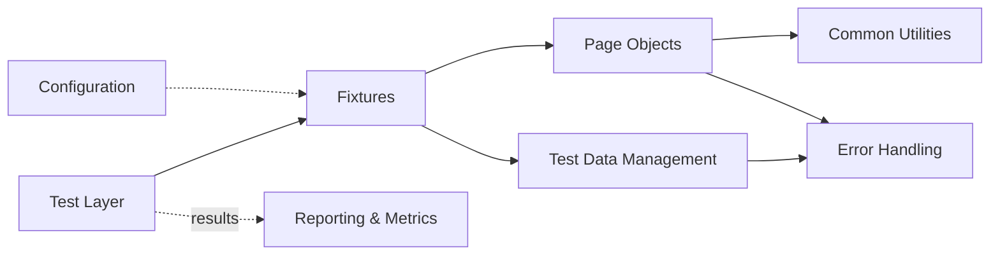

# SQAF — Software Quality Automation Framework


A multi-layer functional test automation framework built with **Playwright** and **TypeScript**, designed to be maintainable, scalable and easy to integrate into QA processes.

SQAF is developed as the practical component of an undergraduate thesis (TFG) in Software Quality Management Engineering, and as a professional portfolio project.

> **Project status: Stage 0 — Bootstrap, baseline and CI.**
> The SQAF layers are **not implemented yet**. This repository currently contains the project foundation and an experimental *baseline* used to evaluate the framework later. See [Roadmap](#roadmap).

---

## Objectives

- Design a multi-layer architecture that separates tests, page objects, test data, utilities, error handling and reporting.
- Support **Page Object Model** and **Data-Driven Testing**.
- Provide centralized configuration, execution evidence and metrics.
- Integrate with **GitHub Actions** from the first stage.
- Evaluate the framework objectively against a baseline implementation.

## System Under Test

[Automation Exercise](https://automationexercise.com/) — a public e-commerce practice site with
[26 official test cases](https://automationexercise.com/test_cases) and a [public API](https://automationexercise.com/api_list).
SQAF targets 15 of those test cases (see [ADR-0002](docs/architecture/decisions/ADR-0002-sut-automation-exercise.md)).

## Architecture

Target architecture (planned — see [architecture.md](docs/architecture/architecture.md)):



## Technology stack

| Tool | Version | Purpose |
|---|---|---|
| Node.js | 26 (`.nvmrc`) | Runtime |
| Playwright Test | 1.65.0 | Test runner and browser automation |
| TypeScript | 7.0.2 | Static typing (`strict`) — see [ADR-0004](docs/architecture/decisions/ADR-0004-typescript-7.md) |
| GitHub Actions | — | Continuous integration |

No additional runtime dependencies are used.

## Project structure

Current structure (Stage 0):

```
.
├── .github/workflows/ci.yml   # CI pipeline
├── baseline/                  # Experimental baseline (no SQAF architecture)
│   └── baseline.spec.ts
├── config/
│   └── ad-blocking.ts         # Ad-blocking policy for the SUT
├── docs/                      # Internal documentation (Spanish)
├── playwright.config.ts
├── tsconfig.json
└── package.json
```

## Installation

Prerequisites: Node.js 26 and Git.

```bash
git clone <repository-url>
cd sqaf-playwright
npm ci
npx playwright install chromium
```

## Configuration

Stage 0 has no environment variables. The base URL (`https://automationexercise.com`) is defined in `playwright.config.ts`. Centralized, environment-based configuration is planned for Stage 1.

## Execution commands

| Command | Description |
|---|---|
| `npm run typecheck` | TypeScript type checking (`tsc --noEmit`) |
| `npm run test:baseline` | Runs the 5 baseline scenarios on Chromium |
| `npm test` | Runs all Playwright projects (currently only the baseline has tests) |
| `npm run report` | Opens the last HTML report |

## Reporting

Playwright's HTML report is generated in `playwright-report/` (not versioned). In CI it is uploaded as a workflow artifact. Multi-format reporting and a custom metrics reporter are planned for Stage 6.

## CI/CD

The [CI workflow](.github/workflows/ci.yml) runs on push to `main`, on pull requests and on manual dispatch:

`checkout → setup Node (.nvmrc) → npm ci → typecheck → install Chromium → baseline (1 worker) → upload HTML report`

## Metrics

Metric definitions and the experimental comparison (baseline vs. SQAF) are planned for Stages 6–7. Stage 0 run records: [E0-baseline-runs.md](docs/validation/E0-baseline-runs.md).

## Roadmap

Status legend: **Planned** (designed only) · **Implemented** (code exists and typechecks) · **Validated** (verified by a real execution with recorded evidence).

| Stage | Capability | Status |
|---|---|---|
| 0 | Git repository, `.gitignore`, `.gitattributes` | Validated |
| 0 | TypeScript 7 strict configuration (`npm run typecheck`) | Validated |
| 0 | Experimental baseline — 5 scenarios (TC1, TC3, TC8, TC9, TC12) | Validated (local, 3 runs) |
| 0 | Ad-blocking policy for the SUT | Validated (local) |
| 0 | GitHub Actions CI workflow | Implemented — pending first remote run |
| 1 | Configuration layer (environments, timeouts, evidence policy) | Planned |
| 2 | Page Object layer and fixtures | Planned |
| 3 | Test Data Management (JSON, typed data, API user provisioning) | Planned |
| 4 | Test layer — 15 functional scenarios, tags, traceability | Planned |
| 5 | Common utilities and error handling | Planned |
| 6 | Reporting and metrics (HTML, JSON, JUnit, MetricsReporter) | Planned |
| 7 | Experimental validation and results | Planned |

## Limitations

- The SUT is a public third-party website: availability and content are outside the project's control.
- Advertising hosts are blocked during test execution, so tests do not reproduce the exact ad-supported user experience.
- Only Chromium is used in Stage 0.

## Documentation

- [Architecture](docs/architecture/architecture.md)
- [Architecture Decision Records](docs/architecture/decisions/)
- [Stage 0 validation records](docs/validation/E0-baseline-runs.md)
