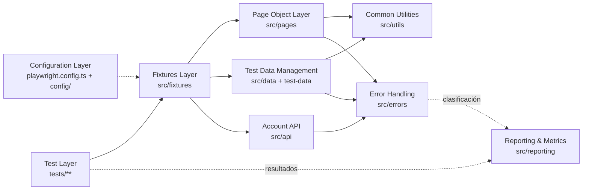
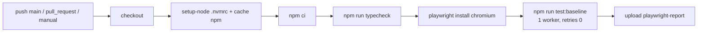

# Arquitectura de SQAF

> **Estado del documento:** Etapa 0. Describe la arquitectura **objetivo** (diseñada) y el estado **real** de la implementación. Ninguna capa de SQAF está implementada todavía.

## 1. Propósito

SQAF (Software Quality Automation Framework) es un framework de automatización de pruebas funcionales con Playwright y TypeScript. Su arquitectura multicapa separa las responsabilidades para que el framework sea **mantenible, escalable y fácil de integrar en los procesos de QA**.

## 2. Vista general (arquitectura objetivo)

**Regla de dependencias (unidireccional):** `tests` → `fixtures` → (`pages`, `data`, `api`) → (`utils`, `errors`). `reporting` solo observa los resultados. Ninguna capa inferior importa una superior.

## 3. Capas y estado

| Capa | Responsabilidad | Ubicación | Estado |
|---|---|---|---|
| Configuration | Configuración centralizada: base URL, proyectos, workers, retries, evidencias, reporters, variables de entorno | `playwright.config.ts`, `config/` | **Parcial**: base URL, proyecto `baseline`, workers en CI y política de anuncios (`config/ad-blocking.ts`). Resto en E1. |
| Test Layer | Escenarios por funcionalidad, aserciones, tags, trazabilidad | `tests/` | Planned (E4) |
| Page Object Layer | Locators, acciones de usuario en lenguaje de negocio, componentes | `src/pages/` | Planned (E2) |
| Fixtures Layer | Inyección de Page Objects y datos, setup y teardown, punto único de importación | `src/fixtures/` | Planned (E2) |
| Test Data Management | Datos externos en JSON, tipos, validación, DDT, cuentas por API | `src/data/`, `test-data/`, `src/api/` | Planned (E3) |
| Common Utilities | Funciones auxiliares independientes del negocio | `src/utils/` | Planned (E3/E5) |
| Error Handling | Errores contextualizados y clasificación de fallos | `src/errors/` | Planned (E5) |
| Reporting & Metrics | Reportes nativos, evidencias, historial, métricas | `src/reporting/`, `metrics/` | Planned (E6) |

## 4. Componentes existentes en la Etapa 0

### 4.1 Línea base experimental (`baseline/`)

Son cinco escenarios oficiales de Automation Exercise (TC1, TC3, TC8, TC9 y TC12), implementados **sin** la arquitectura SQAF: locators y datos dentro de cada test, sin Page Objects ni fixtures propios. Su único propósito es servir de referencia para el experimento comparativo de la Etapa 7. **No debe refactorizarse.**

Se ejecuta como proyecto independiente de Playwright (`baseline`) con Chromium y `retries: 0`.

### 4.2 Política de bloqueo de anuncios (`config/ad-blocking.ts`)

Bloquea por **nombre de host exacto** los dominios publicitarios observados en el tráfico real del SUT. La línea base la aplica en un `beforeEach`, separada de la lógica de los escenarios. SQAF la aplicará mediante una fixture automática (E2). La política es idéntica en ambos casos. Justificación en [ADR-0002](decisions/ADR-0002-sut-automation-exercise.md).

### 4.3 Integración continua (`.github/workflows/ci.yml`)

Ver [ADR-0003](decisions/ADR-0003-ci-github-actions.md).

## 5. Flujo de ejecución actual

1. `npm run test:baseline` invoca Playwright con el proyecto `baseline`.
2. `playwright.config.ts` define `baseURL`, Chromium, los workers (1 en CI) y `retries: 0`.
3. Antes de cada test, `blockAds(context)` registra la regla de bloqueo en el contexto del navegador.
4. Cada escenario navega, interactúa y verifica con aserciones de Playwright con auto-waiting.
5. TC1 elimina su cuenta desde la interfaz. Si el test falla después de crearla, un `afterEach` la elimina por API (solo la cuenta creada en esa ejecución).
6. Playwright genera `playwright-report/`, que en CI se publica como artifact.

## 6. Hallazgos técnicos del SUT relevantes para el diseño

Son hallazgos observados en la Etapa 0, con evidencia en [E0-baseline-runs.md](../validation/E0-baseline-runs.md):

- **Controles enlazados por jQuery.** Los enlaces "Add to cart" (`href="#"`) y el botón `#submit_search` funcionan mediante *handlers* de jQuery registrados al cargar los scripts. Un clic anterior al evento `load` se ignora sin error. **Implicación para E2:** `BasePage` deberá garantizar que la página esté cargada antes de interactuar con estos controles, mediante una espera por condición (`waitForLoadState('load')`), nunca con una espera fija.
- **Etiqueta incorrecta en el formulario de registro.** El `<label>` "Zipcode" apunta a `for="city"`, por lo que `getByLabel('Zipcode')` seleccionaría el campo City. **Implicación:** en ese formulario se prioriza el atributo `data-qa`, que el SUT expone para automatización.
- **Atributos `data-qa`** disponibles en los formularios de login, registro y confirmación de cuenta.
