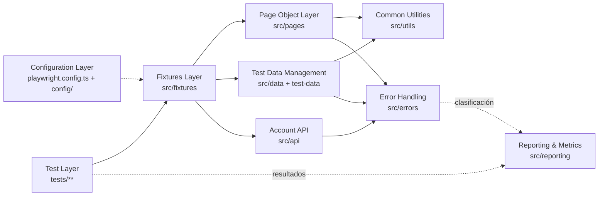
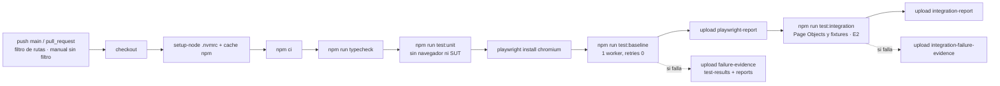
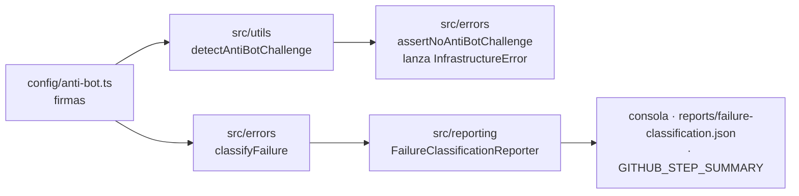
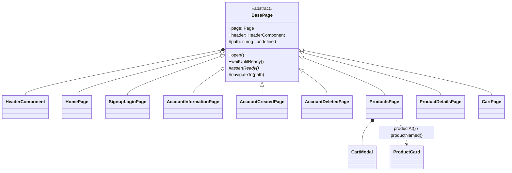
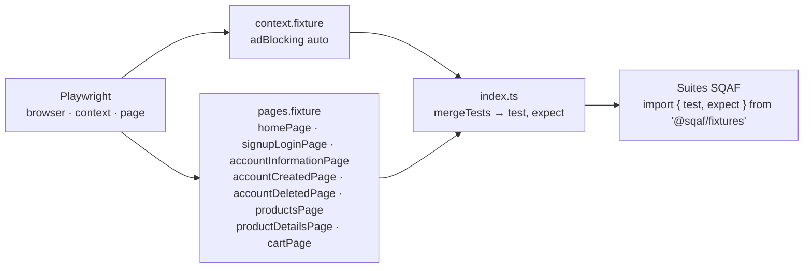

# Arquitectura de SQAF

> **Estado del documento:** Etapa 2. Describe la arquitectura **objetivo** (diseñada) y el estado **real** de la implementación. Están implementadas la capa de configuración (E1) y las capas de Page Objects y fixtures (E2). De las capas de errores, utilidades y reporting solo existen los componentes de detección y clasificación de fallos de infraestructura (ADR-0006).

## 1. Propósito

SQAF (Software Quality Automation Framework) es un framework de automatización de pruebas funcionales con Playwright y TypeScript. Su arquitectura multicapa separa las responsabilidades para que el framework sea **mantenible, escalable y fácil de integrar en los procesos de QA**.

## 2. Vista general (arquitectura objetivo)

**Regla de dependencias (unidireccional):** `tests` → `fixtures` → (`pages`, `data`, `api`) → `errors` → `utils`. `reporting` solo observa los resultados (puede usar `errors` y `utils`). `config` es transversal: cualquier capa puede leerlo y `config` no importa ninguna capa. Ninguna capa inferior importa una superior; en particular, `utils` nunca importa `errors`.

## 3. Capas y estado

| Capa | Responsabilidad | Ubicación | Estado |
|---|---|---|---|
| Configuration | Configuración centralizada: base URL, proyectos, workers, retries, evidencias, reporters, variables de entorno | `playwright.config.ts`, `config/` | **Implemented (E1)**: entornos, variables, timeouts, evidencias, firmas anti-bot y aislamiento de la línea base (ADR-0005) |
| Test Layer | Escenarios por funcionalidad, aserciones, tags, trazabilidad | `tests/` | Planned (E4). En E2 existe `tests/integration/`, que verifica Page Objects y fixtures (no son los 15 escenarios) |
| Page Object Layer | Locators, acciones de usuario en lenguaje de negocio, componentes | `src/pages/` | **Implemented (E2)**: `BasePage`, 3 componentes y 8 páginas (ADR-0007) |
| Fixtures Layer | Inyección de Page Objects y datos, setup y teardown, punto único de importación | `src/fixtures/` | **Implemented (E2)**: bloqueo de anuncios automático, 8 fixtures de Page Objects y `@sqaf/fixtures`. Fixtures de datos y cuentas Planned (E3) |
| Test Data Management | Datos externos en JSON, tipos, validación, DDT, cuentas por API | `src/data/`, `test-data/`, `src/api/` | Planned (E3) |
| Common Utilities | Funciones auxiliares independientes del negocio | `src/utils/` | **Parcial (E1)**: detector anti-bot puro (`anti-bot-detector.ts`). Resto Planned (E3/E5) |
| Error Handling | Errores contextualizados y clasificación de fallos | `src/errors/` | **Parcial (E1)**: `InfrastructureError`, guard anti-bot y clasificación `infrastructure/anti-bot-challenge` (ADR-0006). Taxonomía completa Planned (E5) |
| Reporting & Metrics | Reportes nativos, evidencias, historial, métricas | `src/reporting/`, `metrics/` | **Parcial (E1)**: reporter de clasificación de fallos. Resto Planned (E6) |

## 4. Componentes existentes (Etapas 0, 1 y 2)

### 4.1 Línea base experimental (`baseline/`)

Son cinco escenarios oficiales de Automation Exercise (TC1, TC3, TC8, TC9 y TC12), implementados **sin** la arquitectura SQAF: locators y datos dentro de cada test, sin Page Objects ni fixtures propios. Su único propósito es servir de referencia para el experimento comparativo de la Etapa 7. **No debe refactorizarse.**

Se ejecuta como proyecto independiente de Playwright (`baseline`). Desde la Etapa 1, el proyecto declara explícitamente todas las condiciones de E0 (Chromium, 1 worker, `retries: 0`, timeouts de 30 s y 5 s, sin evidencias, siempre el SUT de producción) y una prueba de contrato las verifica ([ADR-0005](decisions/ADR-0005-configuration-layer.md)).

### 4.2 Política de bloqueo de anuncios (`config/ad-blocking.ts`)

Bloquea por **nombre de host exacto** los dominios publicitarios observados en el tráfico real del SUT. La línea base la aplica en un `beforeEach`, separada de la lógica de los escenarios. SQAF la aplica mediante la fixture automática `adBlocking` (`src/fixtures/context.fixture.ts`, E2), que reutiliza el mismo módulo. La política es idéntica en ambos casos. Justificación en [ADR-0002](decisions/ADR-0002-sut-automation-exercise.md).

### 4.3 Integración continua (`.github/workflows/ci.yml`)

Ver [ADR-0003](decisions/ADR-0003-ci-github-actions.md).

### 4.4 Capa de configuración (`config/`)

| Módulo | Contenido |
|---|---|
| `environments.ts` | Catálogo de entornos (`production`) |
| `environment.ts` | Validación de `SQAF_ENV` y `SQAF_BASE_URL`, carga opcional de `.env`, `ConfigurationError` |
| `timeouts.ts` | Timeouts de SQAF y de la línea base |
| `evidence.ts` | Política de evidencias de SQAF (local y CI) y de la línea base |
| `anti-bot.ts` | Firmas observadas del desafío de Cloudflare |
| `locators.ts` | (E2) Política de localizadores de SQAF: `testIdAttribute: 'data-qa'` |
| `ad-blocking.ts` | Política de bloqueo de anuncios (E0, sin cambios) |
| `index.ts` | `sqafConfig`: punto único de importación, validado e inmutable |

Proyectos de Playwright: `unit` (`tests/unit`, pruebas del framework), `baseline` (`baseline/`), `integration` (`tests/integration`, Chromium, E2), y `chromium`, `firefox` y `webkit` (`tests/e2e`, vacíos hasta E4). Todos los proyectos SQAF comparten `sqafUse`. Detalle en [ADR-0005](decisions/ADR-0005-configuration-layer.md).

### 4.5 Detección y clasificación del desafío anti-bot

- El **guard** lo invoca `BasePage.waitUntilReady()` en cada navegación de SQAF (E2): el test falla con `[SQAF:infrastructure/anti-bot-challenge]`.
- El **reporter** clasifica después de la ejecución todos los intentos fallidos, también los de la línea base, sin modificarla.
- Nada de esto cambia estados, retries ni exit codes, ni intenta evitar el desafío. Detalle en [ADR-0006](decisions/ADR-0006-infrastructure-failure-classification.md).

### 4.6 Capa de Page Objects (`src/pages/`, E2)

| Módulo | Responsabilidad |
|---|---|
| `base.page.ts` | `page` del test, `header`, `open()`, `waitUntilReady()` (`load` → guard anti-bot → `assertReady()`) |
| `components/header.component.ts` | Enlaces Home, Products, Cart, Signup / Login, Logout, Delete Account e indicador "Logged in as" |
| `components/product-card.component.ts` | Un producto de cualquier rejilla: nombre, precio, "View Product" y "Add to cart" (con hover) |
| `components/cart-modal.component.ts` | Modal "Added!": "Continue Shopping" y "View Cart" |
| `home.page.ts` | `/`. Lista cuando el título es `Automation Exercise` |
| `signup-login.page.ts` | `/login`: `login(LoginCredentials)`, `startSignup(SignupIdentity)` y mensaje de error de login |
| `account-information.page.ts` | "Enter Account Information": `fill(AccountDetails)` sin enviar; `createAccount()` (no se usa en E2) |
| `account-created.page.ts`, `account-deleted.page.ts` | Confirmaciones `data-qa` y "Continue". Solo se llega a ellas por un flujo |
| `products.page.ts` | `/products`: rejilla de `ProductCard`, `search(term)` y modal del carrito |
| `product-details.page.ts` | `/product_details/<id>`: `openProduct(id)`, nombre, categoría, precio, disponibilidad, condición y marca |
| `cart.page.ts` | `/view_cart`: filas (`itemAt`, `itemNamed`) y mensaje de carrito vacío |
| `index.ts` | Barrel. Solo lo importa la capa de fixtures |

Los Page Objects exponen `readonly Locator` y acciones de negocio. No contienen aserciones de negocio: la única excepción es `assertReady()`, que es una precondición técnica. Prioridad de localizadores: rol, label o texto, `data-qa` (`getByTestId`), y CSS solo justificado. Las decisiones y la justificación de cada selector CSS están en [ADR-0007](decisions/ADR-0007-page-objects-fixtures.md).

### 4.7 Capa de fixtures (`src/fixtures/`, E2)

**Ciclo de vida de un test SQAF:**

1. Playwright crea un contexto y una página nuevos para el test (D11).
2. La fixture automática `adBlocking` aplica `blockAds(context)` (`config/ad-blocking.ts`, la misma política que la línea base).
3. Cada fixture de Page Object que el test pide se crea en ese momento (perezosa) sobre el **mismo** `page`.
4. El test navega con `open()` o por clic. En el segundo caso, pide la fixture de la página de destino y llama a `waitUntilReady()` (D6).
5. Al terminar, Playwright cierra el contexto: no queda estado (cookies, carrito) para el test siguiente.

`index.ts` exporta solo `test`, `expect` y los tipos de entrada (`LoginCredentials`, `SignupIdentity`, `AccountDetails`). En E3, las fixtures serán el punto donde se conecten los datos (D9).

### 4.8 Verificación de las capas (E2)

| Proyecto o archivo | Qué verifica | Contacta el SUT |
|---|---|---|
| `tests/integration/fixtures/fixtures.spec.ts` | Disponibilidad y clase de las 8 fixtures, `page` compartido, páginas de flujo que no se pueden abrir directamente, bloqueo de anuncios automático y aislamiento entre tests | No |
| `tests/integration/fixtures/anti-bot.spec.ts` | Desafío simulado con `page.route()`: `open()` y `waitUntilReady()` lanzan `InfrastructureError` (`infrastructure/anti-bot-challenge`). Una página que no es un desafío no se clasifica | No |
| `tests/integration/pages/base-page.spec.ts` | `waitUntilReady()` no termina antes del evento `load` | No |
| `tests/integration/pages/{auth,products,cart}.spec.ts` | Page Objects y componentes contra el SUT, reutilización del header y de `ProductCard`, y carrito vacío en un test nuevo | Sí |
| `tests/unit/architecture/dependency-rule.spec.ts` | Regla de dependencias entre capas y ausencia de localizadores crudos en las suites | No |
| `tests/unit/config/sqaf-projects-contract.spec.ts` | Los proyectos SQAF usan la configuración de E1 más `data-qa`; `baseline` no | No |
| `tests/unit/ci/workflow-steps.spec.ts` | Orden de los pasos de CI y salidas separadas de la integración | No |

## 5. Flujo de ejecución actual

### 5.1 Línea base

1. `npm run test:baseline` invoca Playwright con el proyecto `baseline`.
2. `playwright.config.ts` carga `sqafConfig` (que valida el entorno) y aplica al proyecto las condiciones fijas de E0: `baseURL` de producción, Chromium, 1 worker, `retries: 0`, timeouts y evidencias.
3. Antes de cada test, `blockAds(context)` registra la regla de bloqueo en el contexto del navegador.
4. Cada escenario navega, interactúa y verifica con aserciones de Playwright con auto-waiting.
5. TC1 elimina su cuenta desde la interfaz. Si el test falla después de crearla, un `afterEach` la elimina por API (solo la cuenta creada en esa ejecución).
6. Playwright genera `playwright-report/`, que en CI se publica como artifact.
7. El reporter de clasificación registra cada intento fallido con su clasificación (`infrastructure/anti-bot-challenge` o `unclassified`) en la consola, en `reports/failure-classification.json` y, en CI, en el resumen del job.

### 5.2 Suites SQAF (E2: `integration`; E4: `tests/e2e`)

1. `npm run test:integration` invoca Playwright con el proyecto `integration` (Chromium, `sqafUse`: URL del entorno, timeouts y evidencias de SQAF, `data-qa`).
2. Las suites importan `test` y `expect` de `@sqaf/fixtures`.
3. Por cada test: contexto nuevo, la fixture `adBlocking` y las fixtures de Page Objects pedidas (§4.7).
4. Cada navegación termina en `waitUntilReady()`: evento `load`, guard anti-bot y `assertReady()`.
5. El test verifica los resultados con las aserciones de Playwright sobre los localizadores de los Page Objects.
6. Los fallos se clasifican con el mismo reporter de la línea base. En CI, el informe y las evidencias de la integración se publican en artifacts propios.

## 6. Hallazgos técnicos del SUT relevantes para el diseño

Son hallazgos observados en la Etapa 0, con evidencia en [E0-baseline-runs.md](../validation/E0-baseline-runs.md):

- **Controles enlazados por jQuery.** Los enlaces "Add to cart" (`href="#"`) y el botón `#submit_search` funcionan mediante *handlers* de jQuery registrados al cargar los scripts. Un clic anterior al evento `load` se ignora sin error. **Implementado en E2:** `BasePage.waitUntilReady()` espera el evento `load` (`waitForLoadState('load')`) antes de declarar la página lista, nunca con una espera fija. Una prueba offline lo verifica.
- **Etiqueta incorrecta en el formulario de registro.** El `<label>` "Zipcode" apunta a `for="city"`, por lo que `getByLabel('Zipcode')` seleccionaría el campo City. **Implicación:** en ese formulario se prioriza el atributo `data-qa`, que el SUT expone para automatización.
- **Atributos `data-qa`** disponibles en los formularios de login, registro y confirmación de cuenta. Desde E2 se usan con `getByTestId()` (`testIdAttribute: 'data-qa'`).
- **Nombres accesibles con glifos de icono** (observado en E2). Los enlaces del header y "View Product" incluyen un carácter de fuente de iconos antes del texto, así que el nombre de "Home" no es exactamente `Home`. **Implicación:** se usan patrones anclados (`/^\W*Home$/`) en lugar de `exact: true`.
- **Controles sin semántica** (observado en E2). "Add to cart" es un `<a>` sin `href` (sin rol `link`) que el overlay de la tarjeta duplica, y el botón de búsqueda solo tiene un icono (sin nombre accesible ni `data-qa`). **Implicación:** CSS justificado y acotado en `ProductCard` y `ProductsPage` (ADR-0007).
- **Desafío anti-bot de Cloudflare en CI** (observado después de E0). El SUT respondió de forma intermitente a los runners de GitHub con una página de verificación (`One moment, please...`) en lugar de la aplicación: runs `43690859628` (intento 1) y `43691579360`. **Implicación:** detección y clasificación como fallo de infraestructura desde E1, sin evasión ni reintentos especiales ([ADR-0006](decisions/ADR-0006-infrastructure-failure-classification.md)); menos ejecuciones innecesarias contra el SUT mediante filtros de rutas en CI ([ADR-0003](decisions/ADR-0003-ci-github-actions.md)).
