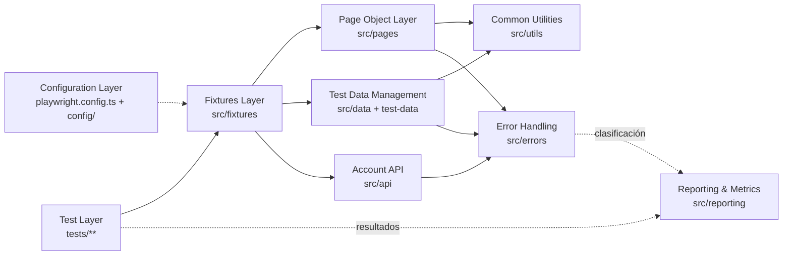
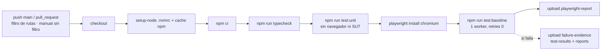
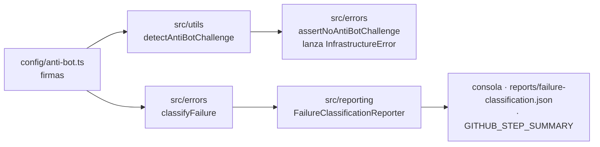

# Arquitectura de SQAF

> **Estado del documento:** Etapa 1. Describe la arquitectura **objetivo** (diseñada) y el estado **real** de la implementación. La capa de configuración está implementada; del resto de capas solo existen los componentes mínimos de detección y clasificación de fallos de infraestructura (ADR-0006).

## 1. Propósito

SQAF (Software Quality Automation Framework) es un framework de automatización de pruebas funcionales con Playwright y TypeScript. Su arquitectura multicapa separa las responsabilidades para que el framework sea **mantenible, escalable y fácil de integrar en los procesos de QA**.

## 2. Vista general (arquitectura objetivo)

**Regla de dependencias (unidireccional):** `tests` → `fixtures` → (`pages`, `data`, `api`) → `errors` → `utils`. `reporting` solo observa los resultados (puede usar `errors` y `utils`). `config` es transversal: cualquier capa puede leerlo y `config` no importa ninguna capa. Ninguna capa inferior importa una superior; en particular, `utils` nunca importa `errors`.

## 3. Capas y estado

| Capa | Responsabilidad | Ubicación | Estado |
|---|---|---|---|
| Configuration | Configuración centralizada: base URL, proyectos, workers, retries, evidencias, reporters, variables de entorno | `playwright.config.ts`, `config/` | **Implemented (E1)**: entornos, variables, timeouts, evidencias, firmas anti-bot y aislamiento de la línea base (ADR-0005) |
| Test Layer | Escenarios por funcionalidad, aserciones, tags, trazabilidad | `tests/` | Planned (E4) |
| Page Object Layer | Locators, acciones de usuario en lenguaje de negocio, componentes | `src/pages/` | Planned (E2) |
| Fixtures Layer | Inyección de Page Objects y datos, setup y teardown, punto único de importación | `src/fixtures/` | Planned (E2) |
| Test Data Management | Datos externos en JSON, tipos, validación, DDT, cuentas por API | `src/data/`, `test-data/`, `src/api/` | Planned (E3) |
| Common Utilities | Funciones auxiliares independientes del negocio | `src/utils/` | **Parcial (E1)**: detector anti-bot puro (`anti-bot-detector.ts`). Resto Planned (E3/E5) |
| Error Handling | Errores contextualizados y clasificación de fallos | `src/errors/` | **Parcial (E1)**: `InfrastructureError`, guard anti-bot y clasificación `infrastructure/anti-bot-challenge` (ADR-0006). Taxonomía completa Planned (E5) |
| Reporting & Metrics | Reportes nativos, evidencias, historial, métricas | `src/reporting/`, `metrics/` | **Parcial (E1)**: reporter de clasificación de fallos. Resto Planned (E6) |

## 4. Componentes existentes (Etapas 0 y 1)

### 4.1 Línea base experimental (`baseline/`)

Son cinco escenarios oficiales de Automation Exercise (TC1, TC3, TC8, TC9 y TC12), implementados **sin** la arquitectura SQAF: locators y datos dentro de cada test, sin Page Objects ni fixtures propios. Su único propósito es servir de referencia para el experimento comparativo de la Etapa 7. **No debe refactorizarse.**

Se ejecuta como proyecto independiente de Playwright (`baseline`). Desde la Etapa 1, el proyecto declara explícitamente todas las condiciones de E0 (Chromium, 1 worker, `retries: 0`, timeouts de 30 s y 5 s, sin evidencias, siempre el SUT de producción) y una prueba de contrato las verifica ([ADR-0005](decisions/ADR-0005-configuration-layer.md)).

### 4.2 Política de bloqueo de anuncios (`config/ad-blocking.ts`)

Bloquea por **nombre de host exacto** los dominios publicitarios observados en el tráfico real del SUT. La línea base la aplica en un `beforeEach`, separada de la lógica de los escenarios. SQAF la aplicará mediante una fixture automática (E2). La política es idéntica en ambos casos. Justificación en [ADR-0002](decisions/ADR-0002-sut-automation-exercise.md).

### 4.3 Integración continua (`.github/workflows/ci.yml`)

Ver [ADR-0003](decisions/ADR-0003-ci-github-actions.md).

### 4.4 Capa de configuración (`config/`)

| Módulo | Contenido |
|---|---|
| `environments.ts` | Catálogo de entornos (`production`) |
| `environment.ts` | Validación de `SQAF_ENV` y `SQAF_BASE_URL`, carga opcional de `.env`, `ConfigurationError` |
| `timeouts.ts` | Timeouts de SQAF y de la línea base |
| `evidence.ts` | Política de evidencias de SQAF (local y CI) y de la línea base |
| `anti-bot.ts` | Firmas observadas del desafío de Cloudflare |
| `ad-blocking.ts` | Política de bloqueo de anuncios (E0, sin cambios) |
| `index.ts` | `sqafConfig`: punto único de importación, validado e inmutable |

Proyectos de Playwright: `unit` (`tests/unit`, pruebas del framework), `baseline` (`baseline/`), y `chromium`, `firefox` y `webkit` (`tests/e2e`, vacíos hasta E4). Detalle en [ADR-0005](decisions/ADR-0005-configuration-layer.md).

### 4.5 Detección y clasificación del desafío anti-bot

- El **guard** lo usarán las fixtures de navegación de SQAF (E2): el test falla con `[SQAF:infrastructure/anti-bot-challenge]`.
- El **reporter** clasifica después de la ejecución todos los intentos fallidos, también los de la línea base, sin modificarla.
- Nada de esto cambia estados, retries ni exit codes, ni intenta evitar el desafío. Detalle en [ADR-0006](decisions/ADR-0006-infrastructure-failure-classification.md).

## 5. Flujo de ejecución actual

1. `npm run test:baseline` invoca Playwright con el proyecto `baseline`.
2. `playwright.config.ts` carga `sqafConfig` (que valida el entorno) y aplica al proyecto las condiciones fijas de E0: `baseURL` de producción, Chromium, 1 worker, `retries: 0`, timeouts y evidencias.
3. Antes de cada test, `blockAds(context)` registra la regla de bloqueo en el contexto del navegador.
4. Cada escenario navega, interactúa y verifica con aserciones de Playwright con auto-waiting.
5. TC1 elimina su cuenta desde la interfaz. Si el test falla después de crearla, un `afterEach` la elimina por API (solo la cuenta creada en esa ejecución).
6. Playwright genera `playwright-report/`, que en CI se publica como artifact.
7. El reporter de clasificación registra cada intento fallido con su clasificación (`infrastructure/anti-bot-challenge` o `unclassified`) en la consola, en `reports/failure-classification.json` y, en CI, en el resumen del job.

## 6. Hallazgos técnicos del SUT relevantes para el diseño

Son hallazgos observados en la Etapa 0, con evidencia en [E0-baseline-runs.md](../validation/E0-baseline-runs.md):

- **Controles enlazados por jQuery.** Los enlaces "Add to cart" (`href="#"`) y el botón `#submit_search` funcionan mediante *handlers* de jQuery registrados al cargar los scripts. Un clic anterior al evento `load` se ignora sin error. **Implicación para E2:** `BasePage` deberá garantizar que la página esté cargada antes de interactuar con estos controles, mediante una espera por condición (`waitForLoadState('load')`), nunca con una espera fija.
- **Etiqueta incorrecta en el formulario de registro.** El `<label>` "Zipcode" apunta a `for="city"`, por lo que `getByLabel('Zipcode')` seleccionaría el campo City. **Implicación:** en ese formulario se prioriza el atributo `data-qa`, que el SUT expone para automatización.
- **Atributos `data-qa`** disponibles en los formularios de login, registro y confirmación de cuenta.
- **Desafío anti-bot de Cloudflare en CI** (observado después de E0). El SUT respondió de forma intermitente a los runners de GitHub con una página de verificación (`One moment, please...`) en lugar de la aplicación: runs `43690859628` (intento 1) y `43691579360`. **Implicación:** detección y clasificación como fallo de infraestructura desde E1, sin evasión ni reintentos especiales ([ADR-0006](decisions/ADR-0006-infrastructure-failure-classification.md)); menos ejecuciones innecesarias contra el SUT mediante filtros de rutas en CI ([ADR-0003](decisions/ADR-0003-ci-github-actions.md)).
